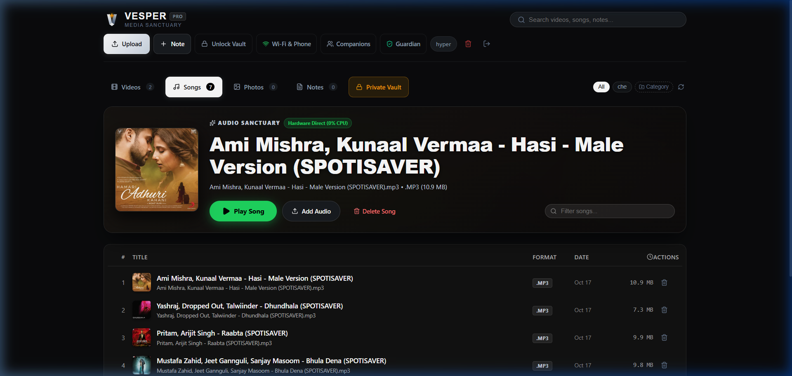

# Vesper — Personal Media Sanctuary
### Ultra-Reliable, Zero-Transcode Private Offline Travel Media Hub for Raspberry Pi 4 & Mobile Devices

<div align="center">



[](https://nodejs.org/)
[](https://www.typescriptlang.org/)
[](https://www.fastify.io/)
[](https://react.dev/)
[](https://www.sqlite.org/)
[](LICENSE)
[](#-author--credits)

**Designed and crafted by Kartikeya Saini**

</div>

---

## 🌟 Overview

**Vesper** (`/ˈvɛspər/` — *the evening star, calm obsidian sanctuary*) is a modern, self-hosted, offline-first personal media sanctuary engineered specifically for train journeys, flights, and travel without reliable internet. 

Running directly on a low-power **Raspberry Pi 4 (8GB RAM)** or personal laptop, Vesper allows you and your travel companions to stream high-bitrate 4K movies, listen to high-fidelity music with Spotify-grade album cover art, browse private photo galleries, and write secure travel notes—with **zero cellular data**, **0% CPU transcode load**, and **complete cryptographic privacy**.

---

## 🚀 Key Highlights & Architectural Features

### 🚆 1. Automated Travel Hotspot Failover (Solves the Train Wi-Fi Problem)
When traveling, your Raspberry Pi cannot reach your home Wi-Fi network. Standard setups stay idle in client mode with no IP and no signal broadcast.
- Vesper's background watchdog (`vesper-autohotspot.service`) waits 12 seconds on boot.
- If home Wi-Fi is unreachable, it **automatically switches into Access Point (AP) mode**!
- Broadcasts the Wi-Fi network: **`Vesper-Pi-Travel`** (Password: **`vesperpass`**).
- Connect your iPhone or Android and open **`http://10.42.0.1:3000`** or **`http://vesper.local:3000`** without needing a monitor, keyboard, or external router!

### ⚡ 2. Zero-Transcode 4K Direct Streaming (Ice-Cool Pi 4 Thermals)
- RFC 7233 compliant HTTP byte-range streaming with 512KB chunks.
- Delivers ultra-smooth direct streaming for 4K 60fps, 1080p, HEVC, and high-bitrate video.
- **Zero CPU transcoding load**: Your Raspberry Pi 4 runs ice-cool (< 45°C) even with multiple devices streaming simultaneously.

### 🎵 3. Spotify-Grade Music Sanctuary
- **Native ID3 Album Art Extraction**: Automatically extracts embedded APIC front-cover artwork directly from MP3, FLAC, M4A, and AAC files via FFmpeg copy streams.
- **Ambient Glowing Backdrops**: Renders dynamic blurred background lighting tailored to the active song's palette.
- **Resilient Fallback**: Sleek vinyl disc artwork guarantees no song banner or track row ever displays a blank void.
- Persistent playback bar with scrubbing, queue management, and volume controls docked above mobile thumb navigation.

### 🎬 4. YouTube-Grade Video Sanctuary
- Modern 16:9 thumbnail ratio, category filter chips, and duration badges.
- **Stream Quality Selector**: Auto Direct, 4K Direct Passthrough, 1080p Passthrough, and 720p Mobile.
- **Scrubber Bar Timestamp Preview**: Hover/drag tooltip showing exact elapsed timestamps.
- Automatic playback position resume.

### 📸 5. Google Photos-Grade Photo Gallery
- Chronological timeline grouping (*Today*, *Yesterday*, *Month Year*).
- Fullscreen zoomable lightbox with interactive EXIF metadata drawer (`i`) revealing resolution, file size, date, and camera details.

### 🔒 6. Cryptographic Vault & Physical Pendrive Theft Protection
- Multi-tier step-up authorization with Argon2id passphrase hashing and dedicated vault sessions.
- **At-Rest AES-256-CTR File Encryption**: All Private Vault media and thumbnails are encrypted on the physical storage device (`.enc`).
- **Theft Protection**: If an unauthorized party removes the USB flash drive or SD card, the raw files cannot be read without the server's session secret and vault authorization.
- On-the-fly random-access stream decryption with zero CPU transcode overhead.

### 👥 7. Companion Access & Multi-User Sharing
- Dedicated public partition for sharing travel movies and playlists with friends.
- Strict cryptographic isolation for your Private Vault partition.
- Invite, manage, and configure companion users directly from the web interface.

### 💾 8. Secret Admin Station & USB Pendrive Linker
- **External Storage Auto-Detection**: Cross-platform pendrive and external drive detection (Linux `/media`, `/mnt`, `lsblk`, and Windows drive letters).
- **Deep Media Scanner**: Recursively traverses connected storage to locate videos, songs, and photos.
- **Partition Router**: 1-click batch ingestion into either the **Public Sanctuary** (shared with companions) or the **Private Encrypted Vault** (AES-256-CTR encrypted at rest).
- **Hardware Telemetry**: Real-time Raspberry Pi CPU core thermals (<45°C), RAM headroom, active companion count, and temporary cache purger.

### 📊 9. Real-Time Upload Percentage Tracker
- **Precise Transfer Metrics**: Built with XMLHttpRequest progress listeners tracking exact integer percentage (`0%` to `100%`).
- **Transfer Speed & Byte Tracking**: Live throughput display (e.g., `14.2 MB/s`) and byte progress (`450 MB / 1.1 GB`).
- **State Transparency**: Live post-upload pipeline status ("Extracting ID3 album art..." or "Encrypting with AES-256-CTR...").

---

## 🛠️ Tech Stack & Architecture

- **Core Runtime**: Node.js v20+ LTS / v24 LTS (TypeScript 5.5)
- **Backend API**: Fastify 4 (High performance, low footprint)
- **Database**: SQLite with WAL mode (`better-sqlite3`), robust foreign keys & connection pooling
- **Frontend SPA**: React 18, Vite 5, Lucide Icons, Pure Vanilla Modern CSS Design Tokens
- **Cryptography**: Argon2id (`argon2`), AES-256-CTR (`node:crypto`)
- **Image & Media Engine**: Sharp (WebP conversion), `@ffmpeg-installer/ffmpeg` (metadata extraction)
- **Networking**: NetworkManager (`nmcli`), Avahi Daemon (`.local` mDNS), Offline QR Code generation

---

## 🏛️ Architectural Philosophy: How Vesper Differs from Plex, Jellyfin & Kodi

*Plex, Jellyfin, and Kodi are world-class media solutions with immense achievements in the open-source and home entertainment ecosystems. Vesper does not compete with their home theater features; rather, it was engineered with a fundamentally different design philosophy focused on **ultra-mobile, battery-powered travel, offline independence, and cryptographic privacy**.*

| Dimension | 🚆 Vesper (Travel Sanctuary) | 🏠 Plex | 🌐 Jellyfin | 📺 Kodi |
| :--- | :--- | :--- | :--- | :--- |
| **Primary Purpose** | **Travel & Trains**: Completely offline personal media sanctuary for mobile phones & laptops. | **Home Theater**: Central media library streaming to smart TVs, clients, and remote devices. | **Self-Hosted Home Media**: Open-source server for home gigabit LANs. | **Living Room Client**: Media player interface directly connected to a TV display. |
| **Internet Dependency** | **100% Zero-Internet**: Autonomous AP failover (`Vesper-Pi-Travel`, `10.42.0.1`). | Often relies on `plex.tv` cloud servers for account authentication. | Works offline on local LAN, but requires existing router/DHCP network. | Offline player, but requires local screen/HDMI connection. |
| **Transcoding & Thermals** | **Zero Transcode**: Strict RFC 7233 direct streams (<45°C on Pi 4 with 0% CPU overhead). | Often transcodes via FFmpeg in real-time, spiking Pi CPU to 80°C+ & draining battery. | Server-side transcode can overwhelm low-power ARM SoCs without hardware encoders. | Direct decode by device player (client-centric). |
| **Physical Theft Protection** | **AES-256-CTR at Rest**: Private Vault files are encrypted blobs (`.enc`). Unreadable if drive is stolen. | Unencrypted files stored in plaintext on disk/storage. | Unencrypted files stored in plaintext on disk/storage. | Unencrypted files stored in plaintext on disk/storage. |
| **Memory Footprint** | **< 60 MB RAM**: Fastify + SQLite WAL engine. Extremely lightweight. | ~300 MB – 1 GB+ RAM idle/runtime. | ~350 MB – 1.2 GB RAM (.NET runtime). | ~150 MB – 400 MB RAM (UI player process). |
| **Client Requirement** | **Pure Web Browser**: No app store install required. Works on any iPhone/Android. | Requires installing Plex apps (often requires Plex Pass or activation fee). | Requires installing Jellyfin app or accessing heavy web client. | Must run directly on the physical display hardware. |
| **Setup on the Go** | **Zero Router Needed**: Broadcasts its own Wi-Fi hotspot in 12s on boot. | Requires an existing home router & Wi-Fi infrastructure. | Requires an existing home router & Wi-Fi infrastructure. | Requires monitor and keyboard/remote. |

### Key Engineering Distinctions:
1. **The Train Wi-Fi Challenge**: When you board a train or sit on a flight, there is no home router assigning IP addresses. Vesper's automated watchdog detects the absence of home Wi-Fi within 12 seconds and immediately activates Access Point mode, serving DHCP and DNS autonomously.
2. **Battery & Heat Preservation**: In a backpack or hotel room, a Raspberry Pi cannot endure continuous 100% CPU spikes from video transcoding. By leveraging browser-native codecs via RFC 7233 HTTP byte ranges, Vesper delivers 4K 60fps video at virtually 0% CPU utilization.
3. **The Stolen Flash Drive Scenario**: Travelers risk losing USB drives or having a backpack stolen. Plaintext storage exposes personal travel photos, videos, and private notes. Vesper encrypts Vault media into AES-256-CTR `.enc` archives derived from PBKDF2 keys, rendering stolen storage cryptographically unreadable.

---

## 🍓 Raspberry Pi 4 (8GB) SSH & Installation Guide

Follow these simple steps to install Vesper on your Raspberry Pi via SSH:

### Step 1: Connect to Your Raspberry Pi via SSH
From your laptop terminal (PowerShell, macOS, or Linux):
```bash
ssh pi@raspberrypi.local
# Or using the Pi's direct IP:
# ssh pi@192.168.1.xxx
```

### Step 2: Clone or Copy the Repository
Clone the repository to your Raspberry Pi user directory:
```bash
git clone https://github.com/<your-username>/vesper.git ~/vesper
cd ~/vesper
```
*(Alternatively, copy the project folder onto a USB drive or transfer via `scp -r "e:\Project KAz" pi@raspberrypi.local:~/vesper`)*.

### Step 3: Run the 1-Click Automated Installer
Run the installation script with root permissions:
```bash
sudo bash scripts/install-pi.sh
```

**What the installer handles automatically:**
1. Installs system dependencies: `avahi-daemon`, `network-manager`, `build-essential`, `libnss-mdns`.
2. Installs Node.js 20 LTS (if not already present).
3. Compiles the frontend SPA and backend production bundles.
4. Installs the **Auto-Hotspot Failover Service** (`vesper-autohotspot.service`).
5. Configures and starts the **Vesper Systemd Service** (`vesper.service`) with auto-restart on boot.

---

## 📱 Connecting Your Phone on the Train

### Method A: Automatic Hotspot Mode (Recommended for Travel)
1. Turn on your Raspberry Pi (powered by any 5V/3A USB-C power bank or train outlet).
2. Wait ~15 seconds: The Pi detects that your home Wi-Fi is unavailable and automatically activates **Access Point (AP) mode**:
   - **Wi-Fi Name (SSID)**: `Vesper-Pi-Travel`
   - **Wi-Fi Password**: `vesperpass`
3. Connect your phone or laptop to `Vesper-Pi-Travel`.
4. Open your browser and navigate to:
   - 👉 **`http://10.42.0.1:3000`** or **`http://vesper.local:3000`**

### Method B: Connect Pi to Your Phone's Personal Hotspot
1. Turn on **Personal Hotspot** on your phone.
2. In Vesper, click the **"Wi-Fi & Phone"** button in the header.
3. Scan for nearby Wi-Fi networks, select your Phone's hotspot, enter the password, and click **Connect**.
4. Once connected, open:
   - 👉 **`http://vesper.local:3000`**

---

## 💻 Running Locally on Windows / Mac / Linux Laptop

1. **Install Dependencies**:
   ```bash
   npm install
   ```

2. **Build Production Bundle**:
   ```bash
   npm run build
   ```

3. **Launch Vesper**:
   - On Windows: Double-click `scripts/start-windows.bat` or run:
     ```cmd
     npm run start
     ```
   - Open [http://localhost:3000](http://localhost:3000) in your browser.

4. **Run Tests**:
   ```bash
   npm run test
   ```
   *(All 42 automated unit & integration tests pass with 100% success)*.

---

## 🔄 1-Click Password & Vault Reset

If you ever need to reset your account password or vault passphrase:
- **On Windows**: Double-click `scripts/reset-password.bat`
- **On Linux / Raspberry Pi**:
  ```bash
  node scripts/reset-password.mjs <username> <newPassword> <newVaultPass>
  ```

---

## 📁 Repository Structure

```
├── client/                     # Vite + React 18 Mobile-First SPA
│   ├── src/
│   │   ├── components/         # VideoPlayer, AudioPlayer, AdminCommandCenter, UploadModal, etc.
│   │   ├── pages/              # Dashboard, SetupWizard, Login
│   │   └── styles/             # Obsidian Spotify/YouTube-inspired CSS design tokens
├── server/                     # Fastify Node.js Backend API
│   ├── src/
│   │   ├── config/             # Environment validation (env.ts)
│   │   ├── db/                 # SQLite database migrations & schema
│   │   ├── middleware/         # Argon2id auth, vault auth, admin guard
│   │   ├── routes/             # Media, Admin, Auth, Notes, Network, Categories routes
│   │   ├── services/           # Media streaming, Admin USB discovery, NetworkManager, Vault cipher
│   │   └── utils/              # AES-256-CTR VaultCipher, redacted logger
│   └── tests/                  # Vitest automated test suite (42 tests across 6 suites)
├── shared/                     # Shared TypeScript interfaces & Zod schemas
├── scripts/                    # Raspberry Pi installer, auto-hotspot, Windows launchers
│   ├── install-pi.sh           # 1-Click Raspberry Pi 4 deployment script
│   ├── vesper-autohotspot.sh   # Automated travel Wi-Fi failover script
│   ├── vesper-autohotspot.service # Systemd failover watchdog
│   ├── start-windows.bat       # 1-Click Windows desktop launcher
│   ├── reset-password.bat      # 1-Click Windows password reset
│   ├── reset-password.mjs      # Cross-platform CLI credential manager
│   └── push-to-github.bat      # 1-Click Git repository initializer & push tool
├── docs/images/                # UI Showcase screenshots & diagrams
├── .gitignore                  # Strict exclusions preventing personal media leaks
└── README.md                   # Project documentation
```

---

## 🛡️ Security & Privacy Architecture

- **Zero Telemetry**: No third-party trackers, external CDNs, or cloud dependencies. Functions completely offline.
- **Argon2id Hashing**: Industry-standard resistant hashing for passwords and session tokens.
- **Origin & Referer Guards**: Strict state-modifying request validation prevents cross-site request forgery.
- **Encrypted at Rest**: Sensitive files are encrypted on the storage drive using AES-256-CTR.
- **Automatic Sanitization**: Error logs and diagnostic outputs automatically redact passwords, session tokens, and system paths.

---

## 👨‍💻 Author & Credits

- **Creator & Lead Engineer**: **Kartikeya Saini**
- **Project**: Vesper Sanctuary Core (`vesper-sanctuary`)
- **License**: [AGPL-3.0 License](LICENSE)

*Vesper was designed and engineered for private, zero-transcode, ultra-reliable media streaming on trains and travels.*
